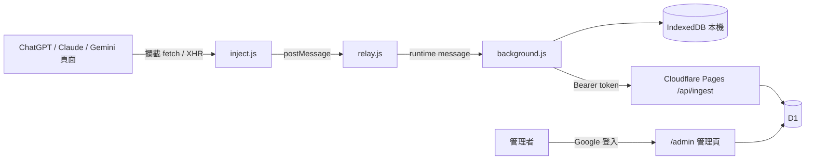

# Prompt Filter（Prompt Vault）

記錄使用者在生成式 AI 網站上**實際送出的 prompt 與上傳檔案**，保存在瀏覽器本機，並可選擇同步到管理者架設的 Cloudflare 伺服器集中查閱。

適用情境：組織內部稽核 AI 使用狀況、個人保存自己的 prompt 歷史。

## 系統特性

- **支援網站**：ChatGPT、Claude、Gemini；NotebookLM 為實驗性支援
- **記錄實際送出的內容**：直接攔截網站送出的請求，而非讀取畫面，可記到完整 prompt、模型名稱與附件資訊
- **上傳檔案**：記錄檔名、類型、大小與 SHA-256 雜湊；30 MB 以下的檔案內容保存在本機
- **本機優先**：所有紀錄先存在瀏覽器 IndexedDB，可搜尋、篩選、匯出 JSON（可含檔案）
- **選擇性雲端同步**：登入後自動上傳到 Cloudflare Pages + D1；檔案只同步 metadata 與雜湊，不上傳檔案內容
- **明確同意**：首次安裝會開啟同意頁，未按同意前不會記錄任何內容；可隨時在 popup 關閉記錄
- **管理後台**：Google 帳號登入（限指定 email），可搜尋所有使用者的紀錄、匯出、管理同步帳號

## 架構

## 目錄

| 目錄 | 說明 |
|---|---|
| [chrome-extension/](chrome-extension/) | Chrome 擴充功能（Manifest V3） |
| [cloudflare/](cloudflare/) | Cloudflare Pages 網站、API 與 D1 資料表 |

## 快速開始

1. 部署伺服器（若只需本機記錄可略過）：見 [cloudflare/README.md](cloudflare/README.md)
2. 安裝擴充功能：見 [chrome-extension/README.md](chrome-extension/README.md)
3. 在管理頁建立使用者帳號，於擴充功能中登入即開始同步

## 隱私與安全

- 擴充功能只在上述 AI 網站運作，不讀取其他網站
- 同步登入只保存 token（7 天有效），不保存密碼；管理者停用帳號後 token 立即失效
- 伺服器密碼以 PBKDF2 雜湊儲存；所有 secrets 只透過 Cloudflare 環境變數設定，不在程式碼中
- 使用前請確認符合所在組織的隱私政策，並告知被記錄的使用者
